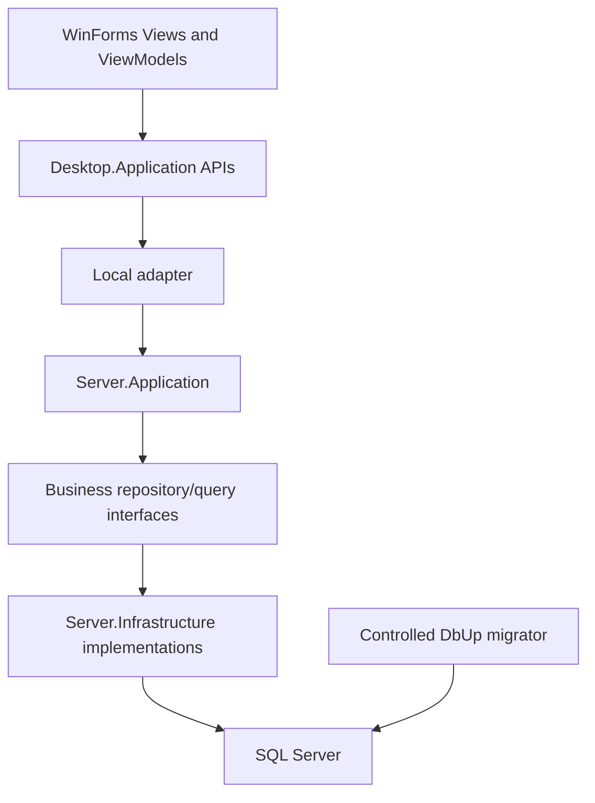

# Architecture — MyDmsVn

**Status:** Current Local v1 architecture on `v1a-pro`, reconciled 2026-10-21 at merged PR #41 baseline `35ba2e8a3f37fb07095701eb94f4b56f7941c491`. RESP, L2DB, GUI-P5 and BCI are implemented/accepted in their approved scopes, with original evidence and exceptions retained. The completed [BCF roadmap](plans/20261021-001-business-compact-lookup-and-visual-parity.md) is COMPLETE / OWNER ACCEPTED for lookup and shell/Products/receipt refinement; [final scope and explicit exceptions](evidence/bcf/20261021-t06-integrated-acceptance.md#final-t06-owner-acceptance--2026-10-21) preserve missing/failed evidence. [Production release prerequisites](DEFERRED_WORK.md#release-prerequisites) remain **UNACCEPTED / UNSCHEDULED**.

T04 source checkpoint (2026-10-22, `7eeafa4`): [reviewed evidence](evidence/sal/20261022-t04-atomic-sales-post.md) records atomic Post on one owned UoW, Shared-before-header and all sorted stock locks before writes, exact duplicate/gift allocation, immutable line cost, paired quantity/value movements and authoritative status/version materialized before commit. Receipt Post and Exclusive reconciliation use the same protocol. Native UI, frozen T08, package and Owner acceptance remain open; this checkpoint is not deployable. T01 R3 remains deferred Minor.

T05 query checkpoint (2026-10-22, `f9149a6`): [reviewed evidence](evidence/sal/20261022-t05-sales-keyset-queries.md) records independently Read-authorized List, strict normalized-filter-bound cursors, typed LINQ Product membership and all-line slim totals, retained-endpoint two-way keyset paging, and page/aggregate/probe on one short owned SERIALIZABLE transaction. Navigation is live across requests; the cursor grants no authority. Native UI and frozen T08/package/Owner acceptance remain open.

T06 Local/VM checkpoint (2026-10-22, `5fbd6f5`): [reviewed evidence](evidence/sal/20261022-t06-local-session-viewmodels.md) records all five session-bound Sales API operations, atomic list snapshots and bounded recovery, guarded stable line/editor models, independent Post permission and shared exact preview. Original-owner binding rejects replacement-user service admission; it does not promise zero API method attempts or UI-thread serialization. Denied Post reload hides protected presentation while retaining private same-owner recovery identity. Native control/raw-buffer/UI, frozen T08/package/Owner and release acceptance remain open.

## SAL development checkpoints and remaining integration

[ADR 0011](adr/0011-direct-sales-and-moving-average-costing.md) and [Direct Sales](DIRECT_SALES.md) define the sole ACTIVE [SAL roadmap](plans/20261021-002-direct-sales-and-moving-average-costing.md). It adds a Sales module inside the existing projects/layers, transport-neutral cursor contracts, explicit Read/Write/Post keys and schema10/value inventory. The planning baseline has schema9/quantity-only stock. Development source has T00 foundations and [reviewed T01 schema10/bootstrap](evidence/sal/20261022-t01-schema-bootstrap.md) at `81e8aab`. The [reviewed T02 checkpoint](evidence/sal/20261022-t02-valued-inventory.md) implements the Shared receipt coordinator, sorted stock locks, quantity/value pairs and Exclusive reconciliation with authoritative stock projections. T03 adds [authorized Draft commands/Get detail](evidence/sal/20261022-t03-sales-draft.md) through existing actor/UoW/repository/DI seams with precommit command responses and a separately owned consistent detail read. T04 implements Sales Post through the shared coordinator, completing the receipt/sale/reconciliation source protocol. Native UI and frozen acceptance remain incomplete. The development checkpoint is not deployable; later workflow/GUI/package acceptance remains open.

The transaction boundary expands to sale status, immutable line costs, quantity/value ledger pairs and balances. Receipt posting and reconciliation now share the transaction-owned protocol; T04 Sales Post joins this same protocol. The [costing specification](DIRECT_SALES_COSTING.md) owns the exact atomicity/bootstrap/locking rules. The [query/UI specification](DIRECT_SALES_QUERY_AND_UI.md) owns LINQ-first filtering, SaleId keyset navigation and the seven-column editor. No new runtime, provider, HTTP host or composition root is introduced.

## 1. Current system and approved direction

MyDmsVn is a Windows desktop modular monolith organized into Identity, Catalog and Inventory with Clean Architecture boundaries. The current product runs on `net48`: WinForms calls Desktop.Application API abstractions, the Local adapter dispatches in-process through Server.Application, and Infrastructure accesses SQL Server.

The [execution roadmap](plans/README.md) records completed BCF and BCI alongside [RESP](plans/20261018-002-respawn-fixture-reuse.md), [L2DB](plans/20261018-001-linq2db-net48-persistence-migration.md) and [GUI-P5](plans/20261019-001-full-winforms-gui-p5-acceptance.md) history. Current product persistence uses LINQ to DB for Catalog/Inventory and typed native SqlClient for Identity/Security/operations; DbUp remains the schema owner. [T07 correctness/package/limited authenticated Local smoke](L2DB_VERIFICATION.md#l2db-t07--frozen-revision-acceptance-and-package-smoke) is accepted in its original scope; GUI-P5 supplies later, separately scoped GUI evidence. Neither acceptance establishes production release readiness. Current Local direct-SQL trust and runtime boundaries are unchanged.

HTTP v2 and modern product runtimes remain [out of scope](DEFERRED_WORK.md#out-of-scope-directions). The future HTTP design preserves the same ViewModels, feature API interfaces, DTOs and Application behavior, with an HTTP adapter and a separately trusted API host. It requires a separate runtime decision before implementation; BCF does not create an HTTP host or restore a modern product target.

The diagram shows the current runtime call path; the host binds interfaces to implementations. Compile-time dependency rules are specified below. Local executes server logic inside the desktop process and is a two-tier deployment. Someone controlling the desktop process or runtime SQL credentials can bypass Application checks. Restricted SQL permissions reduce exposure, but a separately enforceable hostile-client boundary belongs to the deferred HTTP host. Keep maintenance credentials out of Desktop configuration.

## 2. Dependency rules

| Component | Allowed dependencies and responsibility |
|---|---|
| Server.Domain | Shared primitives; no Application, Infrastructure, HTTP or WinForms dependency. |
| Server.Application | Domain and justified Contracts DTOs; handlers, validation, authorization and inner repository/query interfaces. |
| Server.Infrastructure | Application/Domain interfaces; SQL providers, explicit mappings, persistence, identity and operational adapters. |
| Desktop.Application | Contracts; feature API interfaces and ViewModels. |
| Desktop.WinForms | Desktop.Application and presentation controls; no direct SQL or Server.Infrastructure reference. |
| Desktop.Infrastructure.Local | Desktop abstractions and Server.Application dispatch; Infrastructure is wired at the host composition root. |
| Desktop.App | Current net48 host; composes UI, Local adapter, Application and SQL Infrastructure. |
| Future HTTP components | The HTTP adapter depends on Desktop.Application/Contracts; the API host composes Application/Infrastructure. These components are deferred. |

Public Contracts do not expose Domain entities, provider types, ADO.NET connections, transactions, MediatR requests, ErrorOr objects or UI classes. Application handlers do not return HTTP framework results. LINQ to DB types, mapping attributes and `IQueryable` must remain outside inner layers and public contracts when L2DB is implemented.

### Repository resolution and query ownership

`IUnitOfWork.Repository<TRepository>()` is the established typed repository resolver. `IUnitOfWork`, its factory and business repository interfaces live in `Server.Application/Persistence` or the corresponding Application feature. Concrete repository factories and `ISqlExecutionContext` live in Infrastructure.

- Handlers resolve business repository interfaces from an explicitly owned UoW. They do not resolve concrete SQL repositories or arbitrary services.
- Interface-to-implementation registration is explicit. Missing registrations fail clearly; arbitrary first-type assembly scanning is prohibited.
- All participating repositories share the UoW-owned open connection and its current explicit transaction, including asynchronous operations.
- Standalone read services return materialized DTOs and may own a separate connection. A read participating in a command transaction uses that command's connection and transaction.
- Repository lifetime ends with the UoW. Preserve caller-scoped dependencies and the existing transaction/state protections; do not share a UoW across concurrent commands.

See [PERSISTENCE](PERSISTENCE.md) and [ADR 0002](adr/0002-explicit-unit-of-work.md). L2DB changes provider adapters while retaining this ownership model.

## 3. Modules and request handling

Identity owns account validation, code-defined permission evaluation and security administration. Catalog owns Products, Warehouses, Employees and Customers. Inventory owns goods receipt draft/posting, ledger and stock inquiries. Commands, queries, validators, handlers and DTO mapping remain near their feature. New sales, accounting or warehouse capabilities need a separately approved scope.

A request enters a Local adapter, receives an immutable request identity, passes through authentication/authorization and FluentValidation, and reaches an Application handler returning `ErrorOr<T>`. A transport-neutral mapper produces `ApiResponse<T>`. Preserve the current pipeline ordering, deterministic error mapping, field paths, cancellation and safe diagnostics. A future HTTP adapter must preserve the same behavior with meaningful HTTP statuses. See [CONTRACTS](CONTRACTS.md).

## 4. Transactions and inventory invariants

Each explicit UoW owns one connection and at most one transaction. Participating database commands receive that transaction explicitly; ambient/static/AsyncLocal transactions and hidden fallback connections are prohibited. Preserve legal state transitions and cleanup on exceptions/cancellation.

The goods receipt Post use case owns the transaction boundary. Receipt status/rowversion, ledger uniqueness and balance increments succeed or roll back together. Preserve deterministic locking, append-only ledger semantics, atomic increments and reconciliation's explicit `SERIALIZABLE` transaction. Provider replacement does not authorize a new posting algorithm. See [PERSISTENCE](PERSISTENCE.md), [DATA_MODEL](DATA_MODEL.md) and [ADR 0004](adr/0004-p5-ledger-and-posting.md).

## 5. Security

The current security model is implemented. Require a trusted authenticated active subject and a registered Active permission key before loading the current SQL account/binding snapshot; then require that account to remain active. A valid configured and database-bound superuser match bypasses ordinary grants; otherwise a direct-user Allow/Deny wins, followed by active-role grants, with default deny. Unknown/deprecated keys are denied for every account. Session expiry, current account validation and business validation still apply to the superuser.

Code owns the immutable permission catalog; operators own assignments. Application upgrades do not synchronize permissions or auto-grant roles. The protected singleton binding is changed only through separate maintenance authority. Normal runtime SQL uses the allowlisted procedures and cannot perform generic restricted RBAC/binding writes. Retain legacy PasswordHash/PasswordSalt compatibility and atomic audit. See [SECURITY](SECURITY.md) and [ADR 0007](adr/0007-code-defined-permissions-and-single-superuser.md).

## 6. Desktop, runtime and startup

The shared WinForms library and Desktop.App actively target `net48`. Desktop.AppCore still declares `net8.0-windows` in parked source and is excluded from the active solution/release. All ten active test projects target net48 and run directly through `dotnet test`/Test Explorer. The former standalone SQL framework is removed; the .NET 8 SDK remains a build dependency. See [TECH_STACK](TECH_STACK.md) and [PROJECT_STRUCTURE](PROJECT_STRUCTURE.md).

Use thin WinForms views and CommunityToolkit.Mvvm ViewModels, asynchronous feature APIs, deterministic busy/error state and session-aware late-result guards. Desktop.WinForms references the pinned BootstrapSourceGrid project; check its actual source/API and target compatibility before changing presentation dependencies. BCI implemented the app-owned presentation adapter and inline edit lifecycle described in the [accepted design](BUSINESS_COMPACT_UI.md). The [BCF design](BUSINESS_COMPACT_REFINEMENT.md) records implemented lookup binding and presentation refinements while preserving those boundaries; source and final candidate evidence distinguish implemented APIs from historical proposals. Tests creating controls keep STA execution, deterministic disposal and serialized global UI interaction.

Desktop.App configures Microsoft DI once. Local mode requires runtime database configuration and registers Application, SQL Infrastructure and Local dispatch. DbUp runs as a controlled migrator/deployment command, never automatically from client login. Startup validates supported schema and runtime authority without granting privileges or seeding data. A future Remote composition must exclude SQL credentials and server Infrastructure from its client dependency graph.

## 7. Validation and change control

[Test policy](TEST_POLICY.md) owns execution scope. Use focused affected tests at task boundaries; broaden SQL coverage for shared fixture/UoW/migration changes and GUI coverage for changed UI behavior. BCI retains its [accepted historical evidence](BUSINESS_COMPACT_ACCEPTANCE.md); BCF retains its [completed bounded acceptance](BUSINESS_COMPACT_REFINEMENT_ACCEPTANCE.md), while new obligations follow [SAL acceptance](DIRECT_SALES_ACCEPTANCE.md). [TEST_STRATEGY](TEST_STRATEGY.md) describes required behavior coverage, not another execution queue.

Keep explicit non-production SQL configuration, local allocation ownership/cleanup, finite waits and independent case evidence. SQL projects execute sequentially; interrupted allocations require manual review because no external lease/watchdog/orphan recovery service remains. RESP fixture reuse and the L2DB conversion are completed; preserve their accepted fixture boundaries, reset behavior and direct test commands. Historical acceptance is retained in [HISTORY](HISTORY.md), with unresolved [release prerequisites](DEFERRED_WORK.md#release-prerequisites) outside the active execution queue.

Changes to runtime, transport contracts, authorization, transaction ownership, password migration or ledger semantics require an explicit decision and corresponding ADR. BCF preserved these architectural boundaries. ADR 0011 explicitly approves the SAL contract/valuation additions while retaining connection, layer and security ownership.
