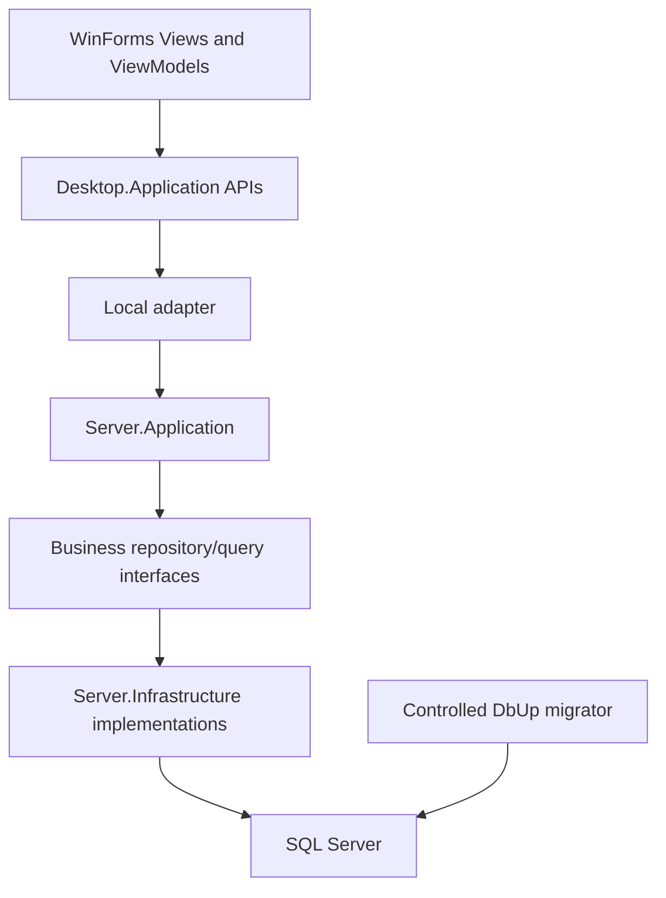

# Architecture — MyDmsVn

**Status:** Current Local v1 architecture on `v1a`, refreshed 2026-10-19 against PR #37 merge `42d94ba`. RESP fixture reuse and L2DB-T00–T07 migration/correctness/package/limited Local smoke are completed and accepted in plan scope. Full GUI/P5 and production P6 G1–G5 acceptance remain OPEN under the newly approved plans; no current release readiness is implied.

## 1. Current system and approved direction

MyDmsVn is a Windows desktop modular monolith organized into Identity, Catalog and Inventory with Clean Architecture boundaries. The current product runs on `net48`: WinForms calls Desktop.Application API abstractions, the Local adapter dispatches in-process through Server.Application, and Infrastructure accesses SQL Server.

The [execution roadmap](plans/README.md) now records completed [RESP](plans/20261018-002-respawn-fixture-reuse.md) and [L2DB](plans/20261018-001-linq2db-net48-persistence-migration.md), followed by OPEN [GUI-P5](plans/20261019-001-full-winforms-gui-p5-acceptance.md) and [REL/P6](plans/20261019-002-local-v1-p6-release-acceptance.md). Current production uses LINQ to DB for Catalog/Inventory and typed native SqlClient for Identity/Security/operations; DbUp remains the schema owner. [T07 correctness/package/limited authenticated Local smoke](L2DB_VERIFICATION.md#l2db-t07--frozen-revision-acceptance-and-package-smoke) is accepted; its full Desktop GUI cases and P6 release acceptance were not performed. Current Local direct-SQL trust and tested runtime scope are unchanged.

HTTP v2 remains deferred backlog. Its design preserves the same ViewModels, feature API interfaces, DTOs and Application behavior, with an HTTP adapter and a separately trusted API host. It requires a separate runtime decision before implementation; neither the completed infrastructure work nor the GUI-P5/REL plans create an HTTP host or restore a modern product target.

The diagram shows the current runtime call path; the host binds interfaces to implementations. Compile-time dependency rules are specified below. Local executes server logic inside the desktop process and is a two-tier deployment. Someone controlling the desktop process or runtime SQL credentials can bypass Application checks. Restricted SQL permissions reduce exposure, but a separately enforceable hostile-client boundary belongs to the deferred HTTP host. Keep maintenance credentials out of Desktop configuration.

## 2. Dependency rules

| Component | Allowed dependencies and responsibility |
|---|---|
| Server.Domain | Shared primitives; no Application, Infrastructure, HTTP or WinForms dependency. |
| Server.Application | Domain and justified Contracts DTOs; handlers, validation, authorization and inner repository/query interfaces. |
| Server.Infrastructure | Application/Domain interfaces; SQL providers, explicit mappings, persistence, identity and operational adapters. |
| Desktop.Application | Contracts; feature API interfaces and ViewModels. |
| Desktop.WinForms | Desktop.Application and presentation controls; no direct SQL or Server.Infrastructure reference. |
| Desktop.Infrastructure.Local | Desktop abstractions and Server.Application dispatch; Infrastructure is wired at the host composition root. |
| Desktop.App | Current net48 host; composes UI, Local adapter, Application and SQL Infrastructure. |
| Future HTTP components | The HTTP adapter depends on Desktop.Application/Contracts; the API host composes Application/Infrastructure. These components are deferred. |

Public Contracts do not expose Domain entities, provider types, ADO.NET connections, transactions, MediatR requests, ErrorOr objects or UI classes. Application handlers do not return HTTP framework results. LINQ to DB types, mapping attributes and `IQueryable` must remain outside inner layers and public contracts when L2DB is implemented.

### Repository resolution and query ownership

`IUnitOfWork.Repository<TRepository>()` is the established typed repository resolver. `IUnitOfWork`, its factory and business repository interfaces live in `Server.Application/Persistence` or the corresponding Application feature. Concrete repository factories and `ISqlExecutionContext` live in Infrastructure.

- Handlers resolve business repository interfaces from an explicitly owned UoW. They do not resolve concrete SQL repositories or arbitrary services.
- Interface-to-implementation registration is explicit. Missing registrations fail clearly; arbitrary first-type assembly scanning is prohibited.
- All participating repositories share the UoW-owned open connection and its current explicit transaction, including asynchronous operations.
- Standalone read services return materialized DTOs and may own a separate connection. A read participating in a command transaction uses that command's connection and transaction.
- Repository lifetime ends with the UoW. Preserve caller-scoped dependencies and the existing transaction/state protections; do not share a UoW across concurrent commands.

See [PERSISTENCE](PERSISTENCE.md) and [ADR 0002](adr/0002-explicit-unit-of-work.md). L2DB changes provider adapters while retaining this ownership model.

## 3. Modules and request handling

Identity owns account validation, code-defined permission evaluation and security administration. Catalog owns Products, Warehouses, Employees and Customers. Inventory owns goods receipt draft/posting, ledger and stock inquiries. Commands, queries, validators, handlers and DTO mapping remain near their feature. New sales, accounting or warehouse capabilities need a separately approved scope.

A request enters a Local adapter, receives an immutable request identity, passes through authentication/authorization and FluentValidation, and reaches an Application handler returning `ErrorOr<T>`. A transport-neutral mapper produces `ApiResponse<T>`. Preserve the current pipeline ordering, deterministic error mapping, field paths, cancellation and safe diagnostics. A future HTTP adapter must preserve the same behavior with meaningful HTTP statuses. See [CONTRACTS](CONTRACTS.md).

## 4. Transactions and inventory invariants

Each explicit UoW owns one connection and at most one transaction. Participating database commands receive that transaction explicitly; ambient/static/AsyncLocal transactions and hidden fallback connections are prohibited. Preserve legal state transitions and cleanup on exceptions/cancellation.

The goods receipt Post use case owns the transaction boundary. Receipt status/rowversion, ledger uniqueness and balance increments succeed or roll back together. Preserve deterministic locking, append-only ledger semantics, atomic increments and reconciliation's explicit `SERIALIZABLE` transaction. Provider replacement does not authorize a new posting algorithm. See [PERSISTENCE](PERSISTENCE.md), [DATA_MODEL](DATA_MODEL.md) and [ADR 0004](adr/0004-p5-ledger-and-posting.md).

## 5. Security

The current security model is implemented. Require a trusted authenticated active subject and a registered Active permission key before loading the current SQL account/binding snapshot; then require that account to remain active. A valid configured and database-bound superuser match bypasses ordinary grants; otherwise a direct-user Allow/Deny wins, followed by active-role grants, with default deny. Unknown/deprecated keys are denied for every account. Session expiry, current account validation and business validation still apply to the superuser.

Code owns the immutable permission catalog; operators own assignments. Application upgrades do not synchronize permissions or auto-grant roles. The protected singleton binding is changed only through separate maintenance authority. Normal runtime SQL uses the allowlisted procedures and cannot perform generic restricted RBAC/binding writes. Retain legacy PasswordHash/PasswordSalt compatibility and atomic audit. See [SECURITY](SECURITY.md) and [ADR 0007](adr/0007-code-defined-permissions-and-single-superuser.md).

## 6. Desktop, runtime and startup

The shared WinForms library and Desktop.App actively target `net48`. Desktop.AppCore still declares `net8.0-windows` in parked source and is excluded from the active solution/release. All ten active test projects target net48 and run directly through `dotnet test`/Test Explorer. The former standalone SQL framework is removed; the .NET 8 SDK remains a build dependency. See [TECH_STACK](TECH_STACK.md) and [PROJECT_STRUCTURE](PROJECT_STRUCTURE.md).

Use thin WinForms views and CommunityToolkit.Mvvm ViewModels, asynchronous feature APIs, deterministic busy/error state and session-aware late-result guards. Desktop.WinForms references the pinned BootstrapSourceGrid project; check its actual source/API and target compatibility before changing presentation dependencies. Tests creating controls keep STA execution, deterministic disposal and serialized global UI interaction.

Desktop.App configures Microsoft DI once. Local mode requires runtime database configuration and registers Application, SQL Infrastructure and Local dispatch. DbUp runs as a controlled migrator/deployment command, never automatically from client login. Startup validates supported schema and runtime authority without granting privileges or seeding data. A future Remote composition must exclude SQL credentials and server Infrastructure from its client dependency graph.

## 7. Validation and change control

[Test policy](TEST_POLICY.md) owns execution scope. Use focused affected tests at task boundaries; broaden SQL coverage for shared fixture/UoW/migration changes and at the RESP/L2DB final milestones. GUI execution is driven by changed UI behavior or a plan-specific packaged smoke. [TEST_STRATEGY](TEST_STRATEGY.md) describes required behavior coverage, not another execution queue.

Keep explicit non-production SQL configuration, local allocation ownership/cleanup, finite waits and independent case evidence. SQL projects execute sequentially; interrupted allocations require manual review because no external lease/watchdog/orphan recovery service remains. RESP may implement its reviewed fixture reuse design; L2DB consumes that accepted baseline and freezes fixture boundaries, reset behavior and direct test commands during DAL conversion. Historical acceptance is retained in [HISTORY](HISTORY.md), with unresolved delivery gates in deferred backlog rather than the active queue.

Changes to runtime, transport contracts, authorization, transaction ownership, password migration or ledger semantics require an explicit decision and corresponding ADR. Both active plans preserve these architectural boundaries.
