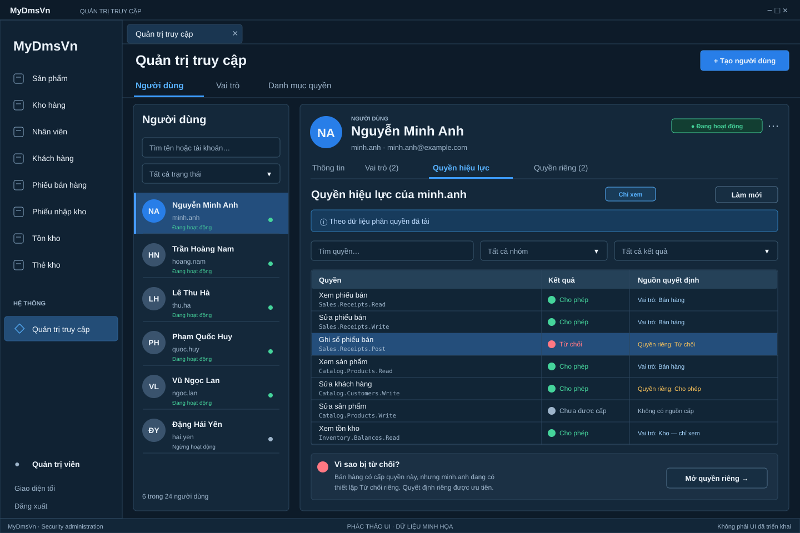
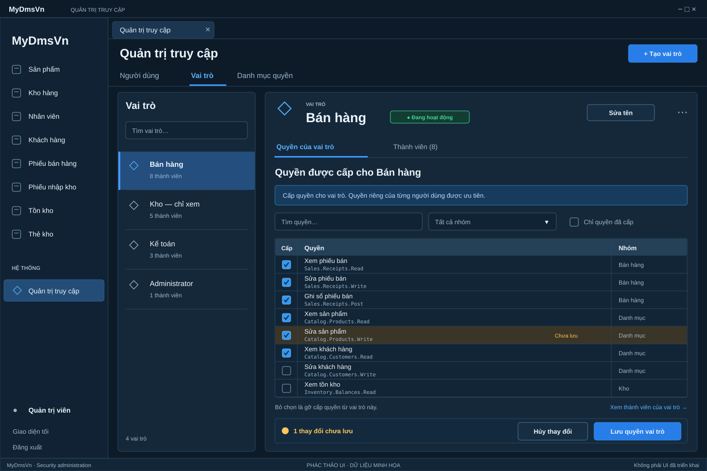
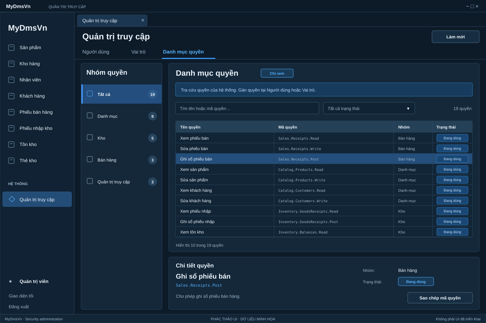

# Security administration — visual references

These three SVG wireframes recreate the three approved conversation layouts using the current specification's labels and canonical permission keys. They are precise composition references for review, not byte copies of the original PNGs, screenshots of an executed application, or evidence of UI Lab acceptance. The deleted image and older variants are excluded.

Read the [UI and behavior specification](../../design/SECURITY_ADMINISTRATION_UI.md), durable [Business Compact policy](../../design/BUSINESS_COMPACT.md), archived [Business Compact and independent UI Labs roadmap](../../archive/20261028-business-compact-and-independent-ui-labs/plans/20261027-001-business-compact-and-independent-ui-labs.md) and [UI Labs review guide](../../development/SECURITY_UI_LAB_REVIEW.md). The specification and the Owner's explicit corrections are normative. The [execution index](../../plans/README.md) now selects the narrow [three-exception correction plan](../../plans/20261028-001-business-compact-exceptions.md); the original visual references remain unchanged and do not approve the new candidate. The original [Security plan](../../archive/20261027-main-roadmap-reset/plans/20261025-002-security-administration-ui-lab-first.md) retains its historical decisions.

## Included views

| File | Applies to |
|---|---|
| [01-user-effective-permissions.svg](01-user-effective-permissions.svg) | Selected-user effective permissions, with membership information confined to the user's Roles tab. |
| [02-role-permissions.svg](02-role-permissions.svg) | Staged role grants, with the detail member count confined to the Members tab. |
| [04-permission-catalog.svg](04-permission-catalog.svg) | Read-only permission catalog with module and lifecycle filters, search and selected-definition details. |

The catalog retains the reference sequence label `04`. No separate direct-editor image is included. Direct decisions, account maintenance, membership changes, import and other workflows are specified in the linked text and must be exercised through the actual Lab scenarios.

## Required interpretation

- User detail headers have no role chips, role list or separate manage-role link on any subtab. Membership information and actions belong to **Vai trò (n)**, including when the direct-decision editor is open.
- Role detail headers have no separate people icon or member-count text beside the active badge. **Thành viên (n)** retains the detail count; a count in the role master list is permitted.
- Role **Thành viên (n)** is read-only. **Mở người dùng** navigates to the selected user's **Vai trò (n)** when authorized and admitted; membership writes remain centralized there. Do not add a second membership editor to the role workspace or imply that all role members have identical effective permissions.
- **Danh mục quyền** is read-only. It provides module and lifecycle filters, search, selected-definition details and **Sao chép mã quyền**. It has no user/role assignment controls, direct editor, Save or registry create/delete actions. **Đang dùng** and **Ngừng dùng** describe definition lifecycle.
- Display exact canonical keys from the catalog and assignment data. Friendly Vietnamese names supplement those keys; they do not replace them or introduce aliases. Unknown or deprecated assignments follow the specification's read-only history rules.
- All sample user, role, member, permission, module and pending-change counts are illustrative. Runtime counts derive from the appropriate successfully loaded data or complete draft scope, including changes hidden by filters. Missing data must not become a fabricated zero count.
- The effective view is read-only and labelled **Theo dữ liệu phân quyền đã tải**. It explains decision sources and missing or stale data as specified. It does not promise a later server authorization result; protected-account status alone does not establish a runtime bypass.
- Role grant checkboxes stage a local draft. **Hủy thay đổi** restores the baseline, while **Lưu quyền vai trò** dispatches ordered single-key commands with the specified partial-success recovery. An unchecked grant means removing that role's grant, not a role-level Deny.
- The Role permissions pilot preserves the structured **Cấp | Quyền | Nhóm** composition, readable canonical-key hierarchy, pending indicators and save/cancel summary. A concatenated checklist containing the same strings is not automatically composition-equivalent. Review the actual table/list choice and keyboard behavior in the independent SEC Lab.
- Direct decisions use **Theo vai trò / Cho phép / Từ chối** and one-key **Lưu quyền này**. The separate editor, draft preview and save/cancel behavior are defined in the specification and demonstrated in the Lab scenarios.
- Reuse existing active/inactive and protected-account semantics, the current shell and pinned theme/control primitives. Provide one clear create action per applicable object context; keep the catalog read-only. Follow the specification's compact layout and explicit action labels.

## Review scope

The SVGs document layout, control ownership and visible copy. Their drawing bounds do not prescribe a WinForms client size or physical monitor scale. The running candidate must fit the existing shell bounds and undergo the required Light/Dark, physical native100/native125, keyboard, focus and workflow review.

The linked UI Labs review guide defines repeatable scenarios and evidence fields. The archived UIL roadmap records bounded native pilot and final candidate approval before its completed product-host parity/handoff. These wireframes and historical executed screenshots do not establish or transfer those decisions to another candidate; the archived roadmap and candidate evidence retain their exact state and remaining confirmation limits.

## Preview

### User — effective permissions

### Role — granted permissions

### Permission catalog

