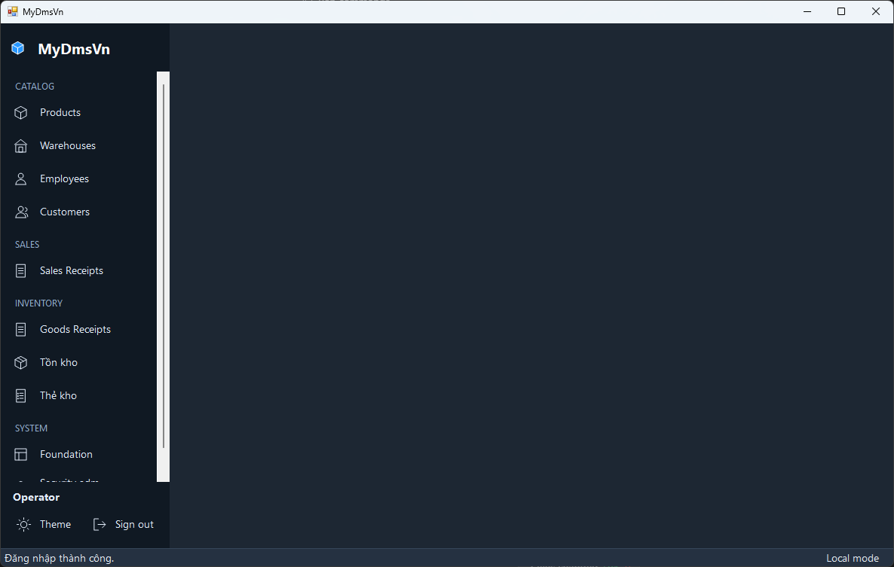
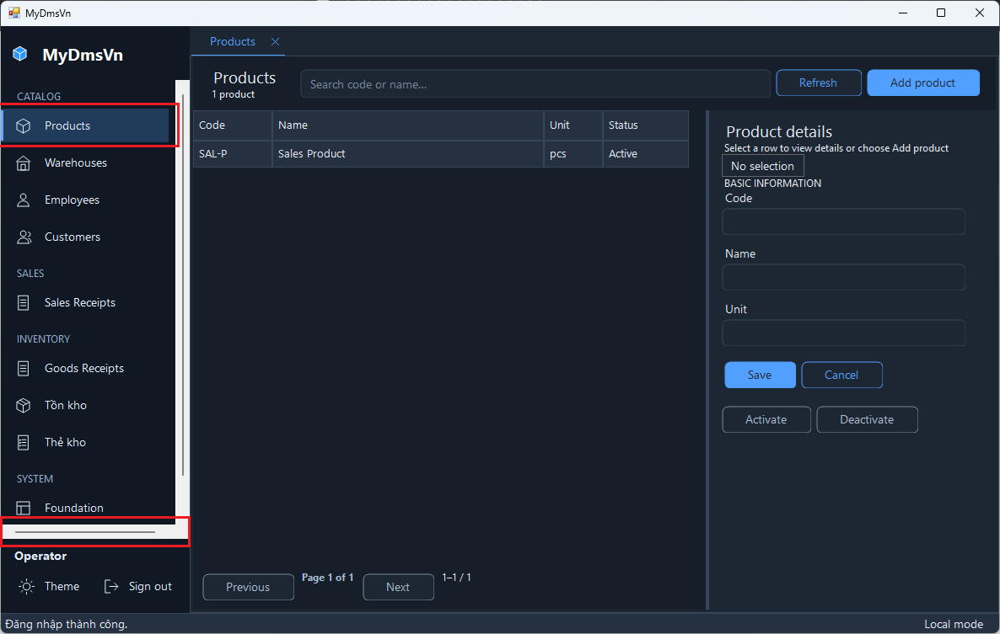

# Sidebar horizontal scrollbar — Owner reference images

These are the original screenshots supplied by the Owner on 2026-10-25 for the [Sidebar fix plan](../../plans/20261025-001-sidebar-navigation-horizontal-scrollbar.md). They were visually reviewed before inclusion and copied without pixel changes.

| File | Observed state | Image dimensions | SHA-256 |
|---|---|---|---|
| [Main-01.png](Main-01.png) | Zero workspace tabs; vertical navigation scrollbar, no horizontal scrollbar. | 1186 × 753 | `b7afb8bd435ce3250997097cbf09b87899f8a8097cc65a6eb2b512530a47c7ef` |
| [Main-02.png](Main-02.png) | Products selected/tab open; horizontal scrollbar above the session area, marked in red by the Owner. | 1186 × 753 | `953603d0b7dee3922953c3d31769cef77e38734ac7355b761aa7a4a172299cd0` |

The image dimensions do not establish the window's client size, physical monitor DPI, app/test/package revision or an internally measured root cause. These are bug-report references, not passing acceptance evidence.

## Empty workspace

## Products opened

