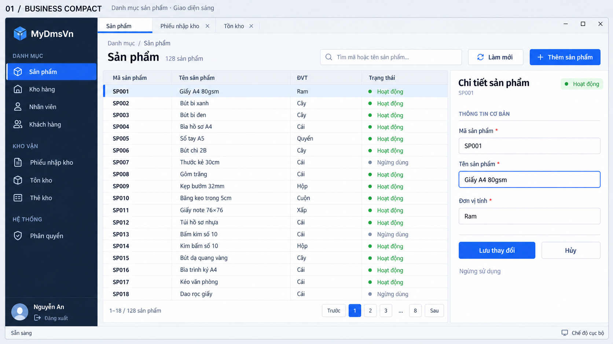
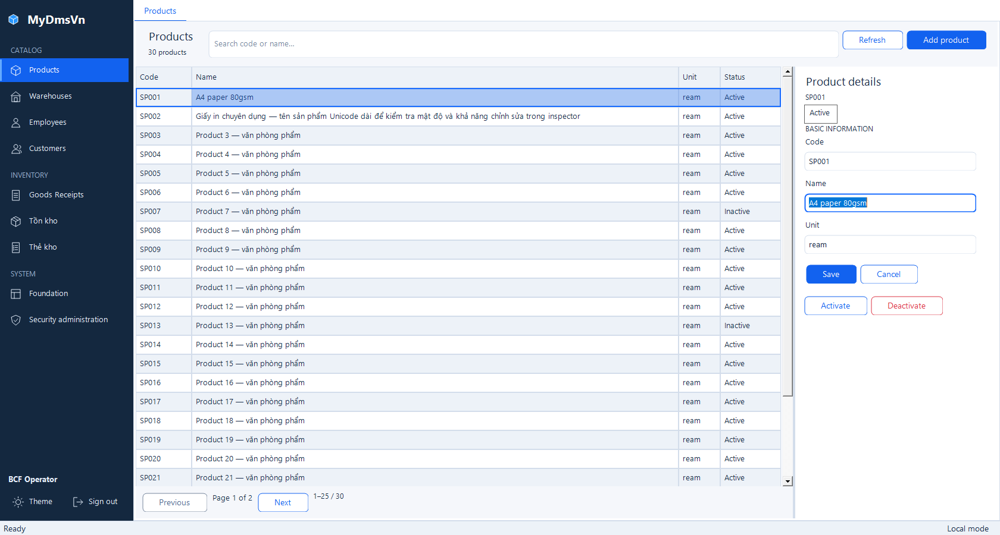
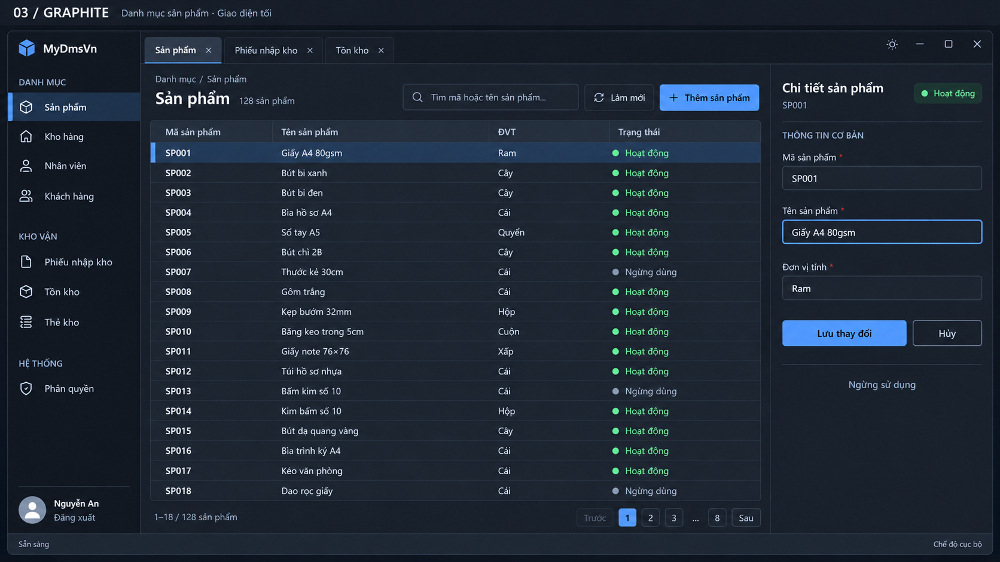
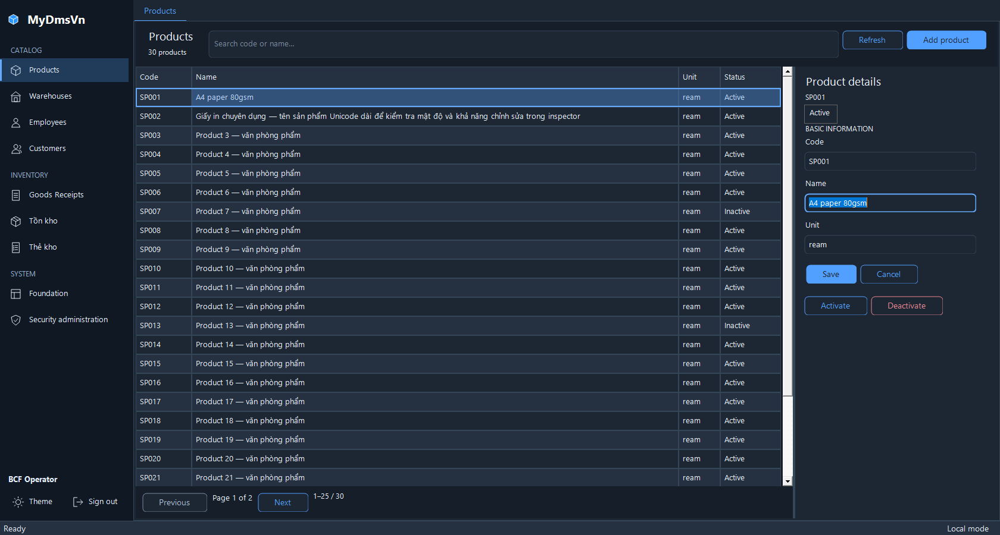
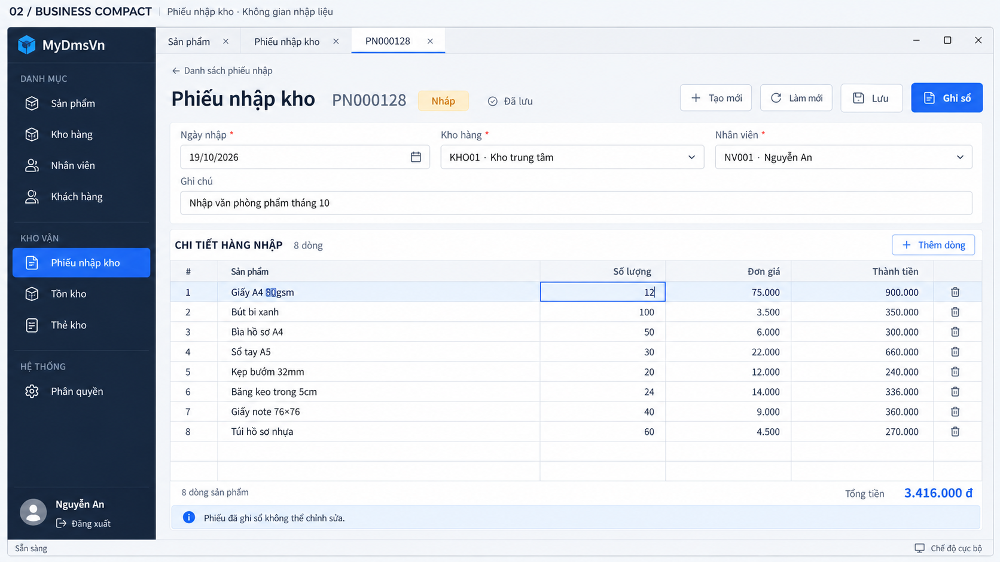
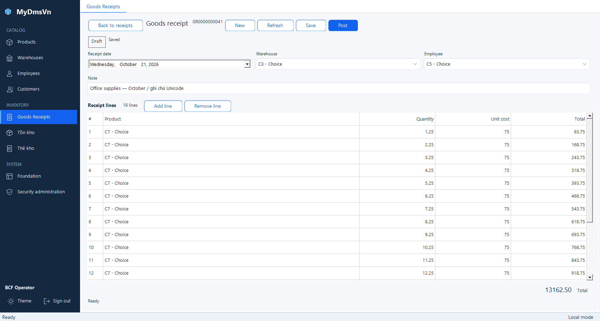
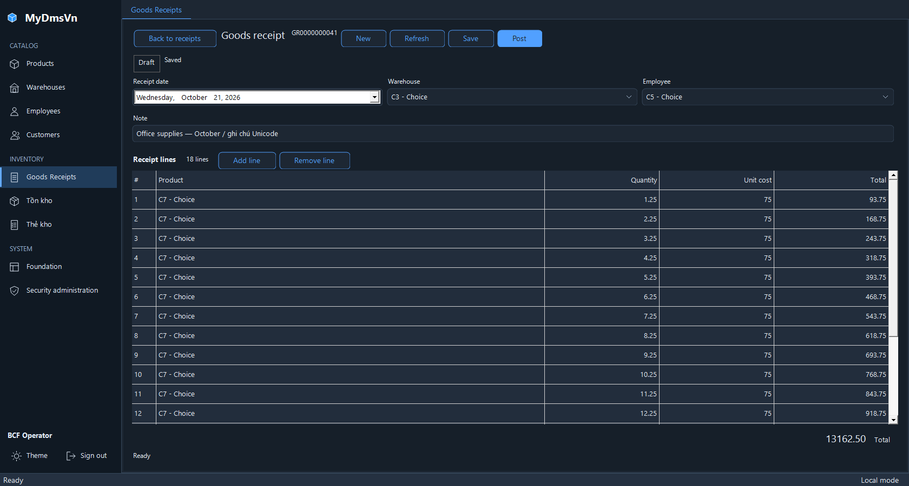

# BCF-T06 — comparison index for Owner review

**Status: OWNER ACCEPTED — 2026-10-21, with the explicit bounded dispositions in the [final record](../20261021-t06-integrated-acceptance.md#final-t06-owner-acceptance--2026-10-21).** [Integrated evidence](../20261021-t06-integrated-acceptance.md) · [Acceptance ledger](../../../BUSINESS_COMPACT_REFINEMENT_ACCEPTANCE.md) · [Original reference register](../../../design-references/business-compact/README.md)

These candidate images are **hosted production-control captures with synthetic clients**, not photographs of packaged Login or SQL-backed data. Actual packaged Login, receipt/catalog workflows and current-candidate attended lookup observations are recorded separately in the integrated evidence. PrintWindow captures contain the measured client area; physical1200 captures use the owned, unoccluded screen client. No image is resized, retouched or synthesized to fill a missing viewport. Original design files remain unchanged.

## Matched fixtures and provenance

Products uses30 synthetic records across two pages, SP001 selected on page1, empty search, Name focus and zero grid scroll. Normal captures show the same30 records/selected identity in both themes; the result footer reports25 records on the current page. The944 captures retain an unsaved Unicode Name edit/range4+2, switch to the opposite theme and scroll the inspector to the final commands. Their filename theme is the **initial** mode: `Light-opposite-theme` is actually Graphite, and `Dark-opposite-theme` is actually Light.

Receipt normal captures use the same saved synthetic receipt41, date2026-10-21, Warehouse3/Employee5, opaque Version,18 lines and total13162.50 in both themes. The list is a separate presentation of the same retained control/session. Constrained dirty/invalid/recovery captures retain18 lines; successful authoritative Refresh gives Posted with one line/total10.00, a deliberately different state. Constrained filenames likewise name the initial mode; the actual theme is its opposite. Selection/scroll and geometry come from the corresponding TRX observations, rather than the image alone.

Native100 measures monitor96/window96 DPI. Native125 requires independently measured monitor120/window96 DPI; this process remains DPI-unaware, so physical screen pixels and logical paint units are distinct. Native125 measures monitor120/window96 DPI on the frozen candidate; the runnable569-row matrix and additional116 Dark lookup rows PASS. The strict1680×900 logical viewport is unavailable at125 on this display; the previously observed fitted1540×845 size is not credited as1680×900. Six strict wide rows remain NOT TESTED under the explicit bounded Owner hardware exception.

## Reference01 — Products / Light

| Original design | Candidate native100,1680×900 client |
|---|---|
|  |  |

## Reference03 — Products / Graphite

| Original design | Candidate native100,1680×900 client |
|---|---|
|  |  |

## Reference02 — Goods Receipt

The final receipt fixture selects the Goods Receipts navigation item as the actual host does. Early captures with no selected navigation remain ignored trial output. These final frames use sourceec4a382, with provenance read after native capture settles layout/scroll.

| Original design | Candidate Light, native1001680×900 | Candidate Graphite, same fixture |
|---|---|---|
|  |  |  |

The Light receipt uses reference02 for layout. Its Graphite counterpart also uses reference03 for palette direction; the Owner supplied no separate Dark receipt raster.

## Supported native125 comparison targets

These1200×760 logical frames correspond to1500×950 physical client pixels at125%; the PrintWindow images remain1200×760. The physical Products captures show the actual OS scaling rather than an image resized for this index.

| Surface | Light | Graphite |
|---|---|---|
| Products1200, native100 | [Light](native100/products-1200-Light.png) | [Graphite](native100/products-1200-Dark.png) |
| Products1200, native125 | [Light](native125/products-1200-Light.png) | [Graphite](native125/products-1200-Dark.png) |
| Products physical1200, native125 | [Light1500×950](native125/products-physical-1200-Light.png) | [Graphite1500×950](native125/products-physical-1200-Dark.png) |
| Receipt saved1200, native100 | [Light](native100/receipt-1200-Light-saved.png) | [Graphite](native100/receipt-1200-Dark-saved.png) |
| Receipt saved1200, native125 | [Light](native125/receipt-1200-Light-saved.png) | [Graphite](native125/receipt-1200-Dark-saved.png) |
| Receipt List1200, native125 | [Light](native125/receipt-1200-Light-list.png) | [Graphite](native125/receipt-1200-Dark-list.png) |
| Products944 after theme switch, native125 | [Actual Light](native125/products-944-Dark-opposite-theme.png) | [Actual Graphite](native125/products-944-Light-opposite-theme.png) |
| Receipt dirty944, native125 | [Actual Light](native125/receipt-1200-Dark-dirty-constrained-opposite-theme.png) | [Actual Graphite](native125/receipt-1200-Light-dirty-constrained-opposite-theme.png) |
| Receipt invalid944, native125 | [Actual Light](native125/receipt-1200-Dark-invalid-constrained-opposite-theme.png) | [Actual Graphite](native125/receipt-1200-Light-invalid-constrained-opposite-theme.png) |
| Receipt recovery944, native125 | [Actual Light](native125/receipt-1200-Dark-recovery-constrained-opposite-theme.png) | [Actual Graphite](native125/receipt-1200-Light-recovery-constrained-opposite-theme.png) |
| Receipt authoritative Posted944, native125 | [Actual Light](native125/receipt-1200-Dark-posted-constrained-opposite-theme.png) | [Actual Graphite](native125/receipt-1200-Light-posted-constrained-opposite-theme.png) |

Native100944 state counterparts are listed by exact filename/hash in the integrity register. The initial theme in constrained filenames is deliberately distinguished from the actual rendered theme. No wide125 image is credited.

## Material differences — final Owner disposition

These differences are visible, not automatically waived by a native-control explanation or by passing behavioral tests. The original rasters include a showcase heading and outer window frame; candidate captures show the measured client only, so those outer presentation regions are not an implemented match.

| Area | Candidate compared with original designs | Current disposition |
|---|---|---|
| Shared composition | Grouped navigation, retained tabs/workspace and bottom session actions exist; standard status bar, underline tabs, smaller native text/heading metrics, tighter spacing, simpler borders and no separate Catalog / Products breadcrumb line differ from the raster | OWNER ACCEPTED / enumerated deviation |
| Products | Code/Name/Unit/Status, toolbar/results/right inspector and selected row exist; no ID primary column. Count30, actual25-row paging with Previous/Next, stacked title/count, textual status, text-only toolbar/search actions and separate Activate/Deactivate differ from the sample128/numbered pages/colored pills/action icons | OWNER ACCEPTED / enumerated deviation |
| Receipt | Detail has Back, title/number, Draft/Saved state, commands, metadata, full-width Note, multiline grid and totals; command grouping/position, text scale, native date display, status badge and separate Remove line differ from the raster/per-row trash | OWNER ACCEPTED / enumerated deviation |
| Copy and sample data | Existing English copy, unchanged mixed inventory navigation labels and synthetic data remain. No localization, new fields, avatar/profile data or exact sample totals are added | OWNER ACCEPTED / existing copy and sample-data boundary |
| Graphite native surfaces | DateTimePicker field/drop arrow, list status ComboBox and native scrollbars can remain light. App-owned tab captions/bevel/focus and pinned lookup chevrons have their separately verified repairs | OWNER ACCEPTED / listed control-specific surfaces |
| Constrained view |944×600 intentionally scrolls/reflows, rather than compressing all fields into the wide reference layout; dirty input/selection and essential commands must remain reachable | OWNER ACCEPTED / actual captures and tests |
| Wide native125 | Six strict shell/Products/receipt rows cannot fit current hardware; no resized or clamped image establishes that target | NOT TESTED / explicit bounded Owner exception accepted |
| T04 Minor | Generic catalog VM ErrorMessage can remain stale after a failed query followed by successful Refresh | DEFERRED MINOR / explicit Owner acceptance; no repair claimed |

## Capture integrity and remaining evidence

The [integrity register](capture-integrity.csv) contains40 reviewed images: native100 Products8+receipt14, native125 Products6+receipt12. The receipt state registers contain [24 native100](receipt-states-native100.txt) and [12 native125](receipt-states-native125.txt) after-Capture records, including states not duplicated as comparison PNGs. SourceGrid custom offsets use its scrollbar units; document AutoScrollPosition uses pixels. For the1200→944 dirty state, active line11/column2 remains retained while first visible line4, grid scrollY3 and document scrollY−136 describe the actual rendered viewport; retention is not a claim that the active line is on screen. Both themes share the same data and transition sequence.

The native125 frames use test source7518e7b; the native100 receipt frames useec4a382. Both use unchanged T05 production controls/vendor pins and the same synthetic fixture. Only reviewed synthetic images belong in this directory. No raw TRX, SQL allocation identity, connection, credential or unreviewed package screenshot is committed.

The Owner accepted this comparison and the enumerated exceptions after reviewing the final three questions. The [final record](../20261021-t06-integrated-acceptance.md#final-t06-owner-acceptance--2026-10-21) also preserves native100 composite attended evidence and its failed-session/no-independent-no-write limitation. Owner acceptance does not relabel missing captures or failed trials as PASS.
