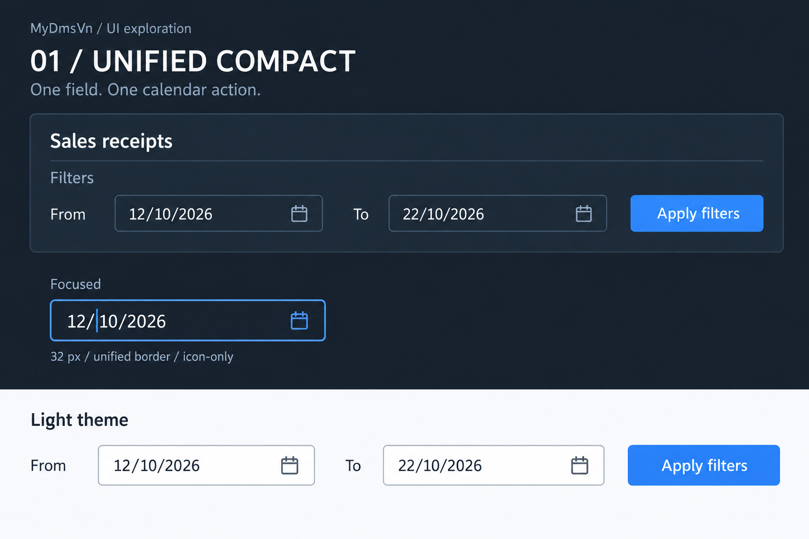

# DateInput — Unified Compact correction design

**Date:** 2026-10-24. **Decision:** Owner selected option 01, Unified Compact. This is the preserved design/inspection record; implementation and running-candidate results were subsequently recorded in [candidate evidence](evidence/20261024-dateinput-unified-compact-correction.md), including the initial failure and bounded acceptance. Current scheduling is owned by the [execution index](../plans/README.md).

**Historical queue:** [UI-NEXT roadmap](20261023-active-roadmap.md), correction tasks UIN-D01–D03. **Implementation record:** [correction plan](20261024-dateinput-unified-compact-correction.md). **Retired handoff:** [Codex prompt](20261024-dateinput-unified-compact-codex-prompt.md).

## 1. Intent and inspected baseline

Make the existing DateInput read as one compact field and keep keyboard edits anchored to the intended date segment. The original scope continued the existing PR chain as a bounded correction to DateInput from T06/T11, with affected T13 integration evidence refreshed. It does not schedule a new correction.

| Repository | PR / branch | Inspected source revision |
|---|---|---|
| MyDmsVn | [#45](https://github.com/chung6a8m/MyDmsVn/pull/45), `codex/uin-t13` → `v1a-pro-ui-next` | `6ff4b9829a4b69f992d75fb52047e991c1843b96` |
| MyDmsVn.BootstrapSourceGrid | [#18](https://github.com/chung6a8m/MyDmsVn.BootstrapSourceGrid/pull/18), `codex/uin-t10-parity` → `main` | `02888dec75878a081f2caac9b22829ae3a2f7d72` |
| MyDmsVn.Bootstrap5WinFormUI | [#73](https://github.com/chung6a8m/MyDmsVn.Bootstrap5WinFormUI/pull/73), `codex/uin-t10-dgv` → `main` | `c91993f4f44a60210f4c6c4106e82ebc69931a0a` |
| SourceGrid | Existing nested dependency; no change selected | `f4e457b43582bf01892f50bdc74aa480531e5944` |

These are inspection anchors, not instructions to reset a newer branch. They describe the original inspection; later implementation/results are in the linked candidate evidence. The original planning commit added no product implementation or runtime PASS.

### Observed problems and source explanation

1. **Clipped date caption on the calendar button.** DateInput puts a full `BootstrapCalendarPicker` in a 38-pixel-wide child. Opening its popup synchronizes `SelectedDate`; the picker still draws `GetSummary()` beside its dropdown icon. The supplied screenshot's `12/10/2026` and `22/10/2026` therefore expose leading `1` and `2` in the narrow button. This is an internal composition problem, not Sales date binding. Sources: [DateInput construction](https://github.com/chung6a8m/MyDmsVn.Bootstrap5WinFormUI/blob/c91993f4f44a60210f4c6c4106e82ebc69931a0a/src/MyDmsVn.Bootstrap5WinFormUI/Controls/BootstrapDateInput.cs#L35-L40), [popup synchronization](https://github.com/chung6a8m/MyDmsVn.Bootstrap5WinFormUI/blob/c91993f4f44a60210f4c6c4106e82ebc69931a0a/src/MyDmsVn.Bootstrap5WinFormUI/Controls/BootstrapDateInput.cs#L165-L181), [picker painting](https://github.com/chung6a8m/MyDmsVn.Bootstrap5WinFormUI/blob/c91993f4f44a60210f4c6c4106e82ebc69931a0a/src/MyDmsVn.Bootstrap5WinFormUI/Controls/BootstrapCalendarPicker.cs#L320-L325).
2. **Up/Down loses the active text position.** `OnEntryKeyDown` reads `CurrentSegment()` from `SelectionStart`, then `SetCandidate` replaces the complete native text without restoring selection. A reset to position zero can make the next arrow edit Day after a Month/Year edit. `PendingTextChanged` is raised afterwards; Sales filter projection is not required to explain the reset. Sources: [candidate replacement](https://github.com/chung6a8m/MyDmsVn.Bootstrap5WinFormUI/blob/c91993f4f44a60210f4c6c4106e82ebc69931a0a/src/MyDmsVn.Bootstrap5WinFormUI/Controls/BootstrapDateInput.cs#L223-L240), [arrow handling](https://github.com/chung6a8m/MyDmsVn.Bootstrap5WinFormUI/blob/c91993f4f44a60210f4c6c4106e82ebc69931a0a/src/MyDmsVn.Bootstrap5WinFormUI/Controls/BootstrapDateInput.cs#L265-L294), [Sales callback](https://github.com/chung6a8m/MyDmsVn/blob/6ff4b9829a4b69f992d75fb52047e991c1843b96/src/MyDmsVn.Desktop.WinForms/SalesReceiptControl.cs#L598-L609).

The diagnoses combine source inspection and Owner observations. They are not a new native reproduction. Existing arrow tests verify date values but do not establish preservation of caret after repeated Month/Year steps.

## 2. Approaches and Owner choice

| Option | Treatment | Disposition |
|---|---|---|
| **01 — Unified Compact** | One outer surface; date text once; embedded icon-only calendar action; ordinary native caret/selection | **Selected** |
| 02 — Segment Focus | Explicit active-segment selection as the visual interaction model | Not selected; do not automatically select a whole segment after an arrow |
| 03 — Date Range Group | Shared visual grouping of the two From/To fields | Not selected; From and To remain independent existing fields |

The image is an enlarged generated design reference, not a runtime screenshot, DPI measurement or pixel-exact acceptance artifact. Its surrounding card, inline labels and Apply button illustrate context; only the DateInput treatment is selected. The normative requirements below govern implementation.

## 3. Selected visual contract

| Element | Requirement |
|---|---|
| Surface | One continuous exterior border/background around the editor and calendar hit area; no second child outline or gap |
| Text | Display the date once, left aligned, with room for the full `dd/MM/yyyy`; preserve native text editing |
| Calendar action | Calendar icon only, using the shared icon/rendering infrastructure; no date caption or extra dropdown chevron |
| Density | Target about 32 logical pixels high at 96 DPI with the normal app font; theme metrics and measured text determine any necessary increase |
| Icon / hit area | About 16 logical pixels for the glyph and 28–32 for its hit area; adequate padding, no overlap with text |
| Corners / colors | Existing theme radius, semantic surface/text/border/focus/invalid/disabled tokens; no separate hard-coded palette |
| Focus | One coherent focus presentation for the composite; clicking the trigger or opening its popup must not destroy pending input |
| Validation | One unified invalid surface; preserve the existing `ValidationState`, ErrorProvider and accessible feedback contract |
| Sizing | Respect host width, larger fonts and actual DPI; preferred height must be stable before/after docking and popup use |
| Themes | Matching geometry in Light/Dark; preserve text, caret, selection and validation during theme/font/DPI changes |

Do not reduce the existing preferred height by assigning a physical `Height = 32` everywhere. Reuse shared metrics/scaling and measure the native text. Preserve the earlier compact-height repair and ensure the calendar glyph stays centered when a host grows the field.

## 4. Keyboard and selection contract

### Successful segment steps

1. Determine Day/Month/Year using the existing segment-selection convention.
2. Snapshot the caret or selection as logical segment positions before changing text.
3. Compute the date with the existing `QuickDateParser.Step` rules.
4. Replace the pending display, then map caret/selection into the same logical segment(s) of the normalized display.
5. Restore native selection before notifying the host through `PendingTextChanged`.

A collapsed caret stays collapsed. A pre-existing selection stays a selection; a whole selected segment maps to the whole corresponding segment. For a range crossing separators, map both endpoints in order rather than silently collapsing it. Segment-start/end endpoints map to the corresponding new boundaries; interior offsets are clamped within their segment. This is a scoped mapping policy for programmatic segment steps, not a new mask or a rewrite of generic `BootstrapTextBox.Text` semantics.

Required examples:

- With `12/10/2026` and caret in Month, two Up presses yield `12/11/2026`, then `12/12/2026`, with caret still in Month after each key.
- With the same input and caret in Year, repeated Up/Down remain Year edits.
- With reference date 23/10/2026 and raw `5/1`, a Month Up normalizes to `05/02/2026`; another Up yields `05/03/2026`. Restoring the old absolute index `2` is wrong because it now falls on the first separator.
- Invalid input, an impossible Month/Year result or a step outside inclusive bounds preserves raw text and selection.

### Preserved semantics

- The accepted `Value` and application model change only at existing admitted commit boundaries. Arrow editing alone must not run a query or save a document.
- Retain strict DMY grammar, optional null versus required empty, bounds, leap-date rejection and midnight/`DateTimeKind.Unspecified` date-only output.
- Retain fresh-candidate reference-clock capture, including an Up/Down-started edit, and freeze the clock while that candidate remains pending.
- Keep native Left/Right/Home/End, typing, copy/paste and IME handling. No rewrite during composition.
- Keep Enter/Tab admission, F4/Alt+Down popup opening, selection preview/acceptance, Escape cancel and one accepted `ValueChanged` notification.
- Read-only, disabled, Posted, busy, denied and recovery-locked inputs must not be mutated through arrows, the calendar action or accessibility.
- Preserve editor/popup disposal and focus restoration; the trigger retains an accessible name/action even though its visible caption is removed.

## 5. Ownership and compatibility

**Shared UI** owns the one-surface composition, embedded calendar trigger, logical caret mapping, native events, accessibility and theme/DPI/lifecycle. Reuse the existing calendar engine. Prefer private/internal composition seams; no public member name is approved or presumed to exist by this document. If a new public API is unavoidable, document its exact surface and compatibility rationale and run the existing API baseline gate.

The standalone `BootstrapCalendarPicker` continues showing its date summary and preserving its existing popup behavior. Generic `BootstrapTextBox.Text` retains ordinary assignment semantics. Add only a narrowly scoped rendering seam if one is demonstrably needed for embedding; default behavior for other callers remains covered by focused characterization.

**BootstrapSourceGrid** transports the reviewed UI pin. Its adapter logic and nested SourceGrid revision are outside this correction unless a concrete integration failure proves a narrow change necessary.

**MyDmsVn** owns the existing required-date and optional-filter profiles, binding, business admission and field placement. Add hosted regressions and adjust host sizing only where the changed preferred size demonstrates a clipping/layout defect. Keep From/To independent. Stock Card's UTC date-time/seconds filter is unchanged.

## 6. Acceptance and evidence boundary

The [validation addendum](20261023-validation-and-handoff.md#dateinput-correction-acceptance) defines UIN-DA01–DA04. UIN-D01/D02 require dual-target shared UI tests; UIN-D03 requires app net48/x86 integration, measured Light/Dark native100/native125, bounded actual-Login DateInput smoke and a dated Owner visual disposition on the corrected build.

Record source, tests, pins and package identity plus actual selected/executed results. Record monitor DPI and window DPI separately; a directory named `125` or a 120-DPI monitor alone does not prove a 120-DPI-aware test window. Original T13 and round-1/round-2 evidence remains historical at its recorded revisions. Preserve original failures and exceptions. No previous count or design approval proves this new candidate passed.

SQL/business/permissions, new range controls, three-field date editors, schema changes, new date/time grammars, global UI restyling, archived SAL acceptance and production release are outside this correction.
